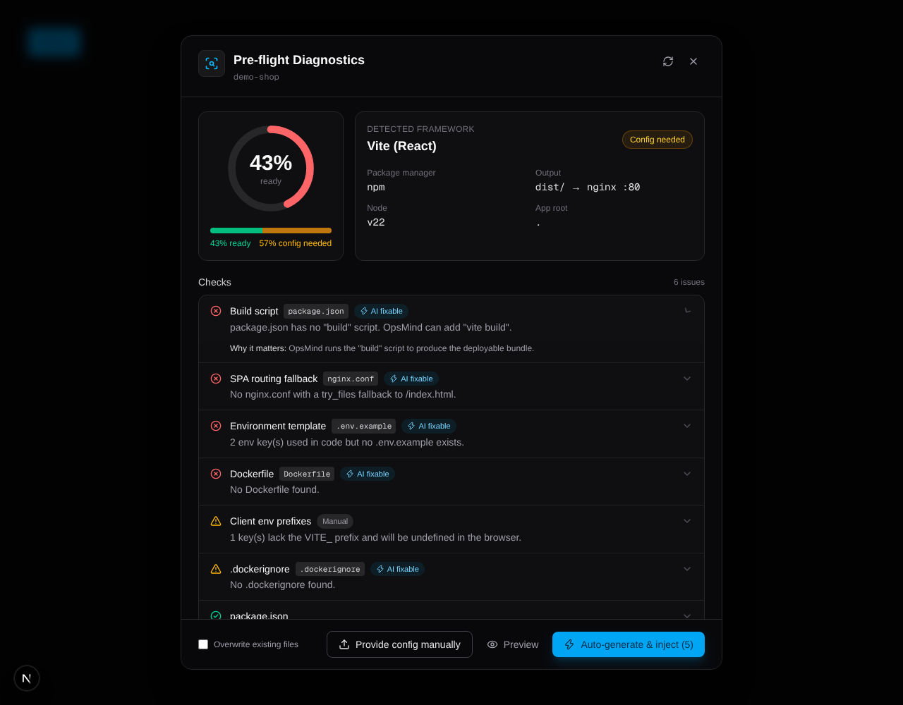

# OpsMind: Frontend Pre-Flight Inspector



Before OpsMind builds a container for a frontend repo, it runs a fast read-only
scan, scores deploy readiness, and offers a one-click fix that generates and
injects the missing configs.

```
backend/
  app/services/frontend_inspector.py   # detection, scoring, config generation, safe writes
  app/api/preflight.py                 # POST /api/inspect/frontend, POST /api/autofix/inject
  app/main.py                          # FastAPI app wiring (CORS + router)
  tests/                               # 31 tests (pytest, Python 3.9+)
frontend/
  lib/preflight.ts                     # typed API client
  components/preflight/FrontendHealthModal.tsx   # dark-themed resolution modal
```

## What is checked

| Check | Weight | Auto-fix |
|---|---|---|
| `package.json` present and valid | 20 | no (dependencies unknown) |
| `build` script present | 15 | yes: patches `package.json` with the framework default |
| Build output dir resolvable (`dist/`, `build/`, `out/`, custom `outDir`/`distDir`) | 10 | no |
| SPA fallback (`nginx.conf` `try_files … /index.html`) when a client router is used | 15 | yes: `nginx.conf` |
| `.env.example` documents every `import.meta.env.*` / `process.env.*` key | 10 | yes: creates or merges |
| Client env keys use the public prefix (`VITE_`, `REACT_APP_`, `VUE_APP_`) | 5 | no (code rename) |
| `Dockerfile` | 15 | yes: multi-stage |
| `.dockerignore` | 5 | yes |
| Lockfile committed | 5 | no |
| No committed `.env` files | 5 | no |

Skipped (not applicable) checks don't count toward the score; a warning counts half.
Status is `ready`, `ready_with_warnings`, `needs_config` (all failures auto-fixable) or
`blocked` (something needs a human).

Frameworks: **Next.js** (server, `standalone`, `export`), **Vite** (React/Vue/Svelte/Preact/Solid),
**Create React App**, **Vue CLI**, **static HTML**. Angular, Nuxt, Astro, SvelteKit, Remix and
Gatsby are recognised and reported as "not supported yet" instead of being misdetected.
Mono-repos are handled when the app lives in `frontend/`, `client/`, `web/`, `apps/web`, etc.

## Generated configs

* **Dockerfile**: `deps → build → runtime` stages with layer caching on the manifest,
  the right install command per package manager (`npm ci`, `yarn --frozen-lockfile`/`--immutable`,
  `pnpm --frozen-lockfile`, bun), the Node version from `.nvmrc`/`engines`, `ARG`s for public env
  keys (inlined at build time) and a `HEALTHCHECK`.
  * Static bundles run on `nginx:1.27-alpine` (port 80).
  * Next.js runs as a non-root user on port 3000; `standalone` output is used when configured.
* **nginx.conf**: SPA fallback, year-long `immutable` caching only for content-hashed folders
  (`/assets/`, `/static/`, `/_next/static/`), `no-cache` HTML shell, gzip, security headers,
  `/healthz`.
* **.env.example**: public keys and server-only keys listed separately; existing templates are merged, never truncated.
* **.dockerignore**: excludes `node_modules`, `.git`, build output and `*.local` env files.

Templates are deterministic (no LLM in the write path), so the same repo always gets the same,
valid files.

## Integrating into OpsMind

Backend (Python 3.9+):

```bash
pip install -r backend/requirements.txt
export OPSMIND_WORKSPACE_ROOT=/var/opsmind/workspaces   # where repos are cloned
export OPSMIND_CORS_ORIGINS=https://app.opsmind.dev
uvicorn app.main:app --app-dir backend --port 8000
```

If you already have a `main.py`, add just one line:

```python
from app.api.preflight import router as preflight_router
app.include_router(preflight_router)
```

Gate your build pipeline on the scan:

```python
from app.services.frontend_inspector import inspect_frontend_repo

report = inspect_frontend_repo(repo_dir)
if report["status"] in ("needs_config", "blocked"):
    return {"stage": "preflight", "report": report}   # UI opens FrontendHealthModal
build_context = os.path.join(repo_dir, report["app_root"])  # docker build context
container_port = report["container_port"]                   # 80 (nginx) or 3000 (Next server)
```

Frontend (Next.js 16, Tailwind v4, `lucide-react`): copy `frontend/lib` and
`frontend/components` into your app (the `@/` alias must point at that root) and set
`NEXT_PUBLIC_OPSMIND_API_URL`.

```tsx
<FrontendHealthModal
  open={showPreflight}
  repoPath="acme/web-app"
  initialReport={pipeline.preflightReport}   // optional; otherwise the modal scans itself
  onClose={() => setShowPreflight(false)}
  onProceed={() => startBuild()}
/>
```

## API

`POST /api/inspect/frontend`: `{ "repo_path": "acme/web-app" }` → full report.

`POST /api/autofix/inject`:

```jsonc
{
  "repo_path": "acme/web-app",
  "mode": "auto",            // or "manual"
  "items": ["dockerfile"],   // optional; default = every auto-fixable item
  "files": [{ "path": "nginx.conf", "content": "..." }],  // manual mode only
  "overwrite": false,
  "dry_run": false           // true returns file contents without writing (used by Preview)
}
```

The response contains `written`, `skipped` (with reasons), `notes` and the fresh `report`.

## Security notes

* `repo_path` is resolved under `OPSMIND_WORKSPACE_ROOT`; anything outside returns 400.
* Writes are limited to a whitelist (`Dockerfile`, `.dockerignore`, `nginx.conf`, `.env.example`,
  `public/_redirects`, plus the patched `package.json` in auto mode). Paths with `..`, absolute paths
  and symlinked parent folders are rejected. Writes are atomic, and a symlinked target is replaced rather than followed.
* Existing files are never overwritten unless `overwrite: true`.
* The server re-inspects before fixing; framework and paths sent by the client are never trusted.
* **Add your auth dependency** to the router (`APIRouter(dependencies=[Depends(current_user)])`).
  These endpoints write to disk.

## Tests

```bash
cd backend && pip install -r requirements.txt && pytest -q
```

The generated configs were also verified end to end with real `docker build` + `docker run`:
* Vite + React Router: deep links (`/dashboard/settings`) return 200, hashed assets are served
  `immutable` and gzipped, and build-arg env is inlined into the bundle.
* Next.js 16 in both `server` and `standalone` modes: the app serves 200 and the process runs as non-root.
